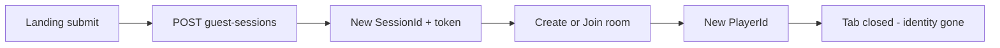
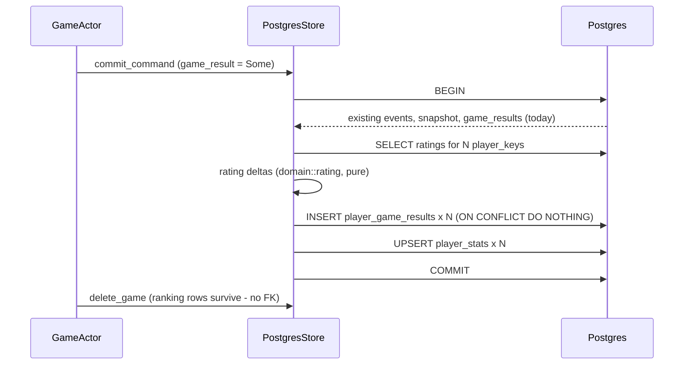
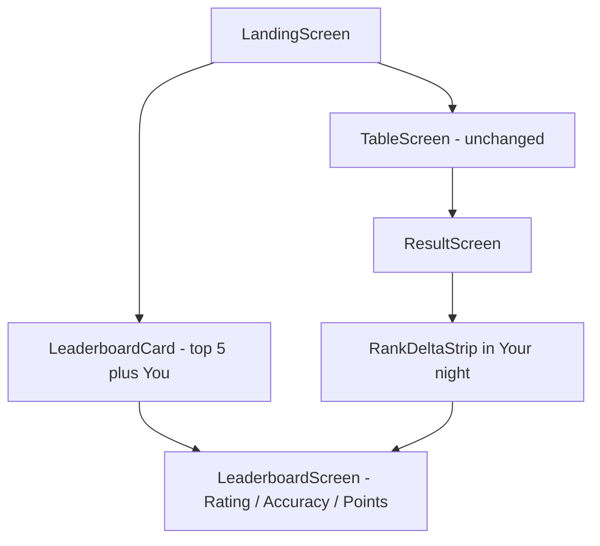

# Persistent Player Ranking — Analysis & Implementation Plan

Drafted: 2026-08-23 · Owner: Chief Architect
Related: [`Architecture.md`](Architecture.md) · [`SECURITY.md`](SECURITY.md) · [`LOAD.md`](LOAD.md) · [`../CTO_PRODUCTION_REVIEW.md`](../CTO_PRODUCTION_REVIEW.md) · [`../PLAN.md`](../PLAN.md) §28

---

## 1. Executive summary

**Goal:** persistent ranking — top 5, my rank, lifetime points, games played — that makes the game more competitive and pulls new players in, **without** disturbing existing UI/UX, the CP realtime path, or the documented NFR envelope.

**Verdict:** feasible and comparatively cheap, but **not** as a bolt-on. Three properties of the current system block it outright, and one existing seam makes it almost free once they are unblocked.

| # | Blocker | Evidence |
|---|---------|----------|
| B1 | **There is no persistent player.** A fresh `SessionId` + `PlayerId` is minted on every Create/Join. | `routes.rs:106` `create_guest_session`, `routes.rs:158` `PlayerId::new()`; client `ApiClient.token` is in-memory only |
| B2 | **Finished games are destroyed within milliseconds.** | `actor.rs:1428` spawns `store.delete_game()` on `GameCompleted`; cascades events/snapshots/results |
| B3 | **The read path has no headroom.** sqlx pool is **10 connections** for a CP gameplay path. | [`LOAD.md`](LOAD.md) production targets |

**The seam:** `CommandCommit` already carries `game_result: Option<GameResultRecord>` (`models.rs:86`) and `commit_command` writes it **inside a transaction** (`postgres.rs:429`) that runs *before* the delete. Extending that same transaction to write immutable per-player stat rows gives us atomic, once-per-game ranking capture with **no new write path on the hot loop and no extra round trip**.

**Headline recommendation:** rank by a **skill rating (placement Elo)**, not by cumulative points — and display points/games as lifetime progress alongside it. Cumulative-points ladders reward volume over skill, are unfarmable-proof, are not comparable across 3-player and 8-player tables, and present new players with an unreachable wall. That last point directly contradicts the stated goal.

---

## 2. Current-state analysis

### 2.1 Identity is fully ephemeral



- `create_guest_session` mints a new session **every** time; nothing is reused.
- `PlayerId` is minted per *room membership*, not per person.
- `guest_sessions` rows are GC'd after 7 days when orphaned (`reaper.rs:16`).
- Nicknames are free text, 1–24 chars, **not unique** — two `Rahul`s collide.
- `room_rejoin.dart` deliberately mints a **fresh** guest session on lobby invite joins so a stored reclaim blob cannot hijack a second join in the same browser. **Any identity scheme must preserve this.**

The CTO review already flags the related symptom — *"Frontend session cliff — refresh mid-game loses in-memory guest token"* — as a Phase A item. Fixing identity for ranking **pays down existing debt** rather than adding new debt.

### 2.2 No durable history exists to backfill from

`GameCompleted` → `delete_game` immediately; the result screen is client-only from the last WS `PlayerGameView`. There is **nothing to migrate**. The leaderboard starts empty from the day it ships, and any game finished before then is unrecoverable. Capture must be at the commit point or not at all.

### 2.3 NFR envelope (the real constraint)

| Metric | Target |
|--------|--------|
| sqlx pool | **10 connections / process** |
| p95 command latency | < 100 ms |
| Persist p95 | < 50 ms |
| Concurrent WS | 200 |
| Active actors | soft cap 100; busy 25 tables, full 35 |

Consequence: a leaderboard **must never run aggregate SQL per request**. `ORDER BY points DESC LIMIT 5` on a landing page every visitor hits would contend with gameplay commits for those 10 connections. The design must be **materialized rows + an in-process cached snapshot**.

### 2.4 Patterns to reuse (do not invent new ones)

| Need | Existing pattern |
|------|------------------|
| Browser storage | conditional-import triple: `x.dart` / `x_stub.dart` / `x_web.dart` (`legal_storage`, `game_reclaim_store`) |
| New store method | `GameStore` trait + **both** `MemoryStore` and `PostgresStore` impls |
| Schema change | numbered additive migration, `IF NOT EXISTS` |
| Counters | `AtomicU64` field on `Metrics` |
| Background job | `spawn_reaper(state)` in `reaper.rs` |
| Ranking math | `ScoreTable::final_ranking` in `judgement-domain/src/score.rs` |
| Result UI | `_PodiumStrip` / `_StandingsTable` / `_YourNightSection` in `result_screen.dart` |

---

## 3. Design decisions

### D1 — Identity: device-anchored handle, keyed by (device, nickname)

**Rejected:** full accounts (email/OAuth). The product thesis is "type a nickname and play". A signup wall before the board is visible would *reduce* new-player conversion — the opposite of the goal. The CTO review scores accounts ~10% and explicitly defers them.

**Chosen:** a high-entropy `device_key` in `localStorage`. On guest-session create the client sends it; the server upserts a `players` row keyed by **`(device_key_hash, nickname_norm)`** and returns a stable `player_key`.

Keying on *(device, nickname)* — not device alone — is what makes this safe alongside `room_rejoin.dart`'s fresh-session rule: two different humans using the same browser sequentially get **distinct** ranking identities, while the guest session stays ephemeral as today.

`device_key` is a ranking credential, so **hash it at rest** from day one. The CTO review lists plaintext session tokens as existing debt; we do not repeat it in new code.

**Honesty requirement:** the UI must say *"Stats are saved to this browser"* — never imply an account. Device change or cleared storage loses stats. D8 adds a transfer path.

### D2 — Ladder metric: placement Elo, with points as lifetime progress

Cumulative points is the naive choice and it is wrong here:

- rewards **volume**, not skill — 200 casual games beat 20 excellent ones;
- not comparable across table sizes or round schedules (a 3-player 13-round game and an 8-player 7-round game produce wildly different totals);
- trivially farmable — three friends, 1-card rounds, repeat;
- presents newcomers an unreachable wall.

**Chosen — three boards, one rating:**

| Board | Sort key | Why |
|-------|----------|-----|
| **Rating** (default) | placement Elo | skill, table-size-normalised, the competitive ladder |
| **Accuracy** | `exact_bid_rounds / rounds_played` | *the* signature skill of Judgement; already in `RankedPlayer`; instantly legible |
| **Points** | lifetime `total_score` sum | what was explicitly asked for; volume-friendly, so newcomers have a board they can climb by playing |

Rating math (pure functions, `judgement-domain/src/rating.rs`, sibling to `score.rs`):

For a table of `N`, treat the finish order as `N(N-1)/2` pairwise matches. For player `i`:

```
E_ij = 1 / (1 + 10^((R_j - R_i) / 400))
A_ij = 1.0 if i finished ahead of j, 0.5 if tied, 0.0 if behind
ΔR_i = (K / (N - 1)) * Σ_{j≠i} (A_ij - E_ij)
```

Dividing by `(N-1)` keeps magnitudes comparable across 3- and 8-player tables. `K = 32`; `K = 64` while provisional (first 10 rated games). Ties reuse the existing shared-rank semantics from `final_ranking`.

**Deliberate omission:** margin of victory. Finishing 2nd by 1 point differs from 2nd by 100, but folding margin in makes the number opaque and farmable. Placement-only for v1; revisit with real data.

### D3 — Dual track: a ladder that can fall, a progression that only rises

A zero-sum Elo ladder alone *discourages* new players (loss aversion). Pair it with monotonic progress so every session shows forward motion even after a loss:

| Can go down | Only goes up |
|-------------|--------------|
| rating, rank position | lifetime points, games played, exact-bid count, badges, best streak |

Plus: provisional players are hidden from the public board; **tier floors** mean a tier once earned is never lost.

### D4 — Monthly seasons + Hall of Fame

A single all-time board ossifies: after three months the top 5 is frozen and no newcomer can crack it. Monthly seasons give every player a reachable target on the 1st; the Hall of Fame preserves long-term bragging rights. This is the **highest-leverage retention lever in the design** and costs one `season_id` column in the stats key.

### D5 — Capture inside the existing commit transaction



Why in-transaction rather than best-effort after: a post-commit write races `delete_game` and loses data on crash. In-transaction is the only way to be exactly-once.

**The tension:** a stat-write failure would roll back the game commit. Mitigations, all required:

1. **Defensive SQL only** — pure upserts, no CHECK constraints on computed values, no FK to a table that may be missing.
2. **`RANKING_ENABLED` env flag** — kills the write path instantly in prod without a deploy.
3. **Idempotency** — `player_game_results` PK `(game_id, player_key)` + `ON CONFLICT DO NOTHING`, so the 2-attempt retry and the commit-uncertainty path can never double-count.

**Correctness rule to hold the line on: ranking must never be able to fail a game.**

### D6 — No FK to `games` or `guest_sessions`

`games` is deleted on finish; `guest_sessions` is GC'd at 7 days. `player_game_results.game_id` is a **bare UUID column with no FK**. `players` has no FK to sessions. Getting this wrong silently deletes the whole leaderboard.

### D7 — Read path: background refresher + materialized rows

- `player_stats` is **one row per (player, season)** — no aggregation at read time.
- A background task (mirroring `spawn_reaper`) refreshes a top-N snapshot every ~45 s into `Mutex<Arc<LeaderboardSnapshot>>` on `AppState`. Reads clone an `Arc` and **never touch the DB**. One query per 45 s regardless of traffic.
- `/me/ranking` = the player's own row + one indexed `COUNT(*) WHERE rating > mine`, memoised ~30 s per player (GC'd like `http_limit` buckets).

Escape hatch if `judgement_persist_commit_duration_milliseconds` p95 regresses: move ranking reads to a **dedicated 2–3 connection pool** so a leaderboard storm can never starve the gameplay commit path. Not needed at launch given the refresher, but pre-decided.

### D8 — Transfer code (P3)

Server issues a short-lived one-time code that rebinds an existing `player_key` to a new `device_key_hash`. Recovers the "cleared my browser" case without introducing accounts.

---

## 4. Data model

Migration `0010_player_identity.sql`:

```sql
-- Persistent ranking identity. Deliberately NOT FK'd to guest_sessions:
-- those rows are GC'd after ORPHAN_SESSION_TTL (7d) while players persist.
CREATE TABLE IF NOT EXISTS players (
    player_key       UUID PRIMARY KEY,
    device_key_hash  TEXT        NOT NULL,   -- hashed at rest (D1)
    nickname_norm    TEXT        NOT NULL,   -- casefolded + trimmed
    display_name     TEXT        NOT NULL,
    discriminator    SMALLINT    NOT NULL,   -- Rahul#4821
    created_at       TIMESTAMPTZ NOT NULL DEFAULT now(),
    last_seen_at     TIMESTAMPTZ NOT NULL DEFAULT now(),
    UNIQUE (device_key_hash, nickname_norm)
);
CREATE UNIQUE INDEX IF NOT EXISTS players_display_uniq
    ON players (nickname_norm, discriminator);

-- Carry player_key so the actor has it in memory (zero extra reads at commit)
-- and restore-on-boot repopulates it.
ALTER TABLE guest_sessions ADD COLUMN IF NOT EXISTS player_key UUID;
ALTER TABLE game_players   ADD COLUMN IF NOT EXISTS player_key UUID;
```

Migration `0011_player_ranking.sql`:

```sql
-- Append-only ledger, one row per player per finished game.
-- No FK on game_id: the row must survive delete_game (actor.rs:1428).
CREATE TABLE IF NOT EXISTS player_game_results (
    game_id           UUID        NOT NULL,
    player_key        UUID        NOT NULL REFERENCES players (player_key) ON DELETE CASCADE,
    season_id         TEXT        NOT NULL,
    finished_at       TIMESTAMPTZ NOT NULL DEFAULT now(),
    table_size        SMALLINT    NOT NULL,
    rounds_played     SMALLINT    NOT NULL,
    finish_rank       SMALLINT    NOT NULL,
    total_score       INT         NOT NULL,
    exact_bid_rounds  SMALLINT    NOT NULL,
    tricks_missed     INT         NOT NULL,
    rating_before     INT         NOT NULL,
    rating_delta      INT         NOT NULL,
    counted           BOOLEAN     NOT NULL,  -- false = recorded but unrated (§6)
    PRIMARY KEY (game_id, player_key)
);
CREATE INDEX IF NOT EXISTS player_game_results_player_idx
    ON player_game_results (player_key, finished_at DESC);

-- Materialized aggregate: no read-time aggregation (D7).
CREATE TABLE IF NOT EXISTS player_stats (
    player_key         UUID   NOT NULL REFERENCES players (player_key) ON DELETE CASCADE,
    season_id          TEXT   NOT NULL,
    rating             INT    NOT NULL DEFAULT 1000,
    games_played       INT    NOT NULL DEFAULT 0,
    games_rated        INT    NOT NULL DEFAULT 0,
    wins               INT    NOT NULL DEFAULT 0,
    podiums            INT    NOT NULL DEFAULT 0,
    lifetime_points    BIGINT NOT NULL DEFAULT 0,
    rounds_played      INT    NOT NULL DEFAULT 0,
    exact_bid_rounds   INT    NOT NULL DEFAULT 0,
    tricks_missed      BIGINT NOT NULL DEFAULT 0,
    best_game_points   INT    NOT NULL DEFAULT 0,
    current_day_streak INT    NOT NULL DEFAULT 0,
    best_day_streak    INT    NOT NULL DEFAULT 0,
    last_played_on     DATE,
    updated_at         TIMESTAMPTZ NOT NULL DEFAULT now(),
    PRIMARY KEY (player_key, season_id)
);
CREATE INDEX IF NOT EXISTS player_stats_ladder_idx
    ON player_stats (season_id, rating DESC, games_rated DESC);
```

Retention: prune `player_game_results` older than 180 days (extend `reaper.rs`). `player_stats` is bounded by player count and stays tiny.

---

## 5. API surface

| Endpoint | Auth | Cache | Notes |
|----------|------|-------|-------|
| `GET /api/v1/leaderboard?season=&board=rating\|accuracy\|points&limit=5` | public | 45 s process snapshot | never hits DB per request |
| `GET /api/v1/me/ranking` | bearer | 30 s per player | rank, rating, points, games, streak, tier |
| `POST /api/v1/guest-sessions` | — | — | **extended**: request `device_key`; response `player_key`, `display_name` |
| `GET /api/v1/players/{player_key}/ranking` | public | 30 s | P3, profile card |

All new endpoints go through the existing `rate_limit_middleware`, with a stricter IP bucket for the public board. Per [`SECURITY.md`](SECURITY.md) production gate item 8, the checklist is re-run for each.

---

## 6. Anti-abuse

A ladder without these is a farm. All enforced when setting `counted`:

| Guard | Rule |
|-------|------|
| Natural finish only | `GameCompleted` only; `abort_game` never rates |
| Minimum table | ≥ 3 distinct human seats |
| Minimum length | ≥ N rounds (config; default 5) |
| Bot seats | a seat bot-controlled > 25 % of the game is recorded but **not rated** |
| Lineup damping | repeated identical lineups within a rolling window get reduced `K` |
| Provisional | first 10 rated games hidden from the public board |

`counted = false` rows still accrue lifetime points and games played (D3 progression track) — they just do not move rating.

---

## 7. Frontend — three additive touchpoints

No changes to `table_screen.dart`. Nothing on the critical join path.



1. **`widgets/leaderboard_card.dart`** — compact card below the existing create/join `Card` on landing. Top 5 + `You: #23 · 1,140 pts · 18 games`. Fixed height (no layout shift), loaded **after first frame, never awaited by `_submit()`** — the codebase already learned this lesson with `TableMediaSession.prepareBeforeNetwork`. Renders nothing on failure; landing must never break.
2. **`screens/leaderboard_screen.dart`** — full board, three tabs, "You" pinned, season countdown, empty/provisional states.
3. **`result_screen.dart`** — a `_RankDeltaStrip` inside the existing `_YourNightSection`: `+18 rating → #23 ▲4`, plus tier-up badge. This is where the loop closes, at peak dopamine.
4. **`widgets/victory_celebration.dart`** — tier-up flourish (reuses the existing celebration).
5. **`widgets/share_result_card.dart`** — add a rank line to the trophy card, turning ranking into an acquisition loop (see [`marketing/social_playbook.md`](marketing/social_playbook.md)).

New util triple `util/player_identity.dart` / `_stub.dart` / `_web.dart`, matching `legal_storage`.

---

## 8. NFR impact

| Path | Added cost | Verdict |
|------|-----------|---------|
| Bid / play commit | **zero** — untouched | no risk |
| Final commit of a game | 1 `SELECT` + 2N upserts in an existing tx | once per game; the one command whose latency nobody notices |
| Landing load | 1 cached read, 0 DB | no risk |
| `/me/ranking` | 2 indexed queries, 30 s memo | bounded by rate limiter |
| Background refresher | 1 query / 45 s | negligible |
| Storage | ~1 small row per player per game, pruned at 180 d | negligible |

New metrics: `judgement_ranking_games_rated_total`, `judgement_ranking_write_failures_total`, `judgement_leaderboard_refresh_duration_milliseconds`. Gate: **persist p95 must not regress** — verified by extending the k6 `target` scenario with concurrent leaderboard GETs.

---

## 9. Phasing

### P0 — Persistent identity (no visible ranking)
Foundation, and independently valuable: partially closes the CTO review's session cliff.

- migration `0010`
- `judgement-protocol/src/rest.rs`: `CreateGuestSessionRequest.device_key`, response `player_key` + `display_name`
- `routes.rs::create_guest_session`: resolve-or-create `players`, hash device key, allocate discriminator
- `models.rs::NewGamePlayer.player_key`; plumb through `start_game` and `restore.rs`
- frontend `player_identity` triple; send `device_key`
- tests: identity stable across sessions; two nicknames on one browser stay distinct; restore repopulates `player_key`

### P1 — Capture + ladder (server, dark)
- `judgement-domain/src/rating.rs` — pure Elo + tiers + unit tests
- migration `0011`
- `commit_command` extension behind `RANKING_ENABLED`
- `MemoryStore` mirror (trait parity is mandatory)
- background refresher + `AppState` snapshot cache
- `GET /leaderboard`, `GET /me/ranking`
- metrics + rate limits + anti-abuse `counted` rules

### P2 — UI (feature visible)
- landing card, full screen, result-screen delta strip, share card line

### P3 — Retention layer
- season rollover job + Hall of Fame
- streaks (columns already present), badges/titles, daily challenges
- head-to-head rivalry, transfer code (D8)

---

## 10. Beyond ranking — engagement, ranked by leverage

Ordered by (impact on attention span) / (cost + NFR risk):

1. **Monthly seasons + Hall of Fame** — the single biggest retention lever; already in the schema key.
2. **Daily / weekly challenges** — *"win a round on a 0 bid"*, *"3 exact bids in one game"*. Deterministic from data already computed at commit. Reuses the same hook. Gives a reason to open the app on a day you weren't going to.
3. **Streaks** — consecutive days played, and longest exact-bid run (PLAN.md §18.8 already lists it). Strongest known retention mechanic; costs one integer + a date. Use streak **freezes**, never punitive loss.
4. **Titles / badges from real stats** — *"Sniper"* (>60 % exact over 20 games), *"Comeback King"*. Shown next to the nickname **at the table** — visible to others, which is what makes it motivating. Ties into the existing avatar/emote system; zero gameplay risk.
5. **Tier-up moment in `VictoryCelebration`** — nearly free, lands at peak dopamine.
6. **Head-to-head rivalry** — *"You vs Amit: 7–4"*. This product is actually played by the same five people repeatedly; this is the most emotionally resonant stat available and it falls straight out of `player_game_results`.
7. **Shareable rank card** — converts retention into acquisition via the existing share flow.
8. **Private group boards** — a board scoped to a room code / recurring group. Arguably a *better* fit than a global board for a party product, and it sidesteps the global abuse and impersonation surface entirely. Strong candidate to ship **before** the global board.

**Deliberately not doing:** global public chat; real-money or gambling framing; pay-to-win cosmetics; punitive loss-aversion mechanics; anything that makes the board look unreachable to a first-time player.

---

## 11. Risks and open decisions

| Risk | Severity | Mitigation |
|------|----------|------------|
| **Nickname collision / impersonation** on a public board | high | discriminators (`Rahul#4821`); profanity filter for board-visible names (no allow-list exists for free text today — real scope, not a footnote) |
| Rating farming | high | §6 guards |
| Cold start — an empty board is worse than none | medium | provisional state, "N games to qualify", designed empty state; consider seeding via private group boards first |
| Stat loss on cleared storage | medium | honest copy in UI; D8 transfer code |
| Pool contention | medium | D7 refresher; dedicated read pool escape hatch |
| **New PII surface** — publicly displayed names + a persistent identifier | high | `SECURITY.md` update, delete path (`ON DELETE CASCADE` already wired), bump `kLegalAgreementVersion` |
| Ranking write breaks a game commit | **critical** | D5: defensive SQL + `RANKING_ENABLED` + idempotency |

**Decisions needed from product before P1:**

1. **Ladder sort key** — skill rating (recommended) vs. cumulative points as the headline.
2. **Scope** — global public board vs. private group boards first (recommended: group first).
3. **Season cadence** — monthly (recommended) vs. all-time only.

---

## 12. Test plan

| Layer | Coverage |
|-------|----------|
| Unit (`judgement-domain`) | Elo symmetry, zero-sum within a table, tie handling, provisional K, table-size normalisation, tier floors |
| Persistence | **double-commit is idempotent**; `MemoryStore`/`PostgresStore` parity; rows survive `delete_game`; rows survive `guest_sessions` GC |
| Server e2e | finish a game → stats appear → leaderboard reflects; aborted game does **not** rate; bot-heavy seat not rated |
| Load (k6) | `target` scenario + concurrent leaderboard GETs; **gate: persist p95 unchanged** |
| Widget | leaderboard card renders/empty/failure; result-screen delta strip — matching `test/result_screen_test.dart` conventions |

---

## 13. Docs to update on landing

- [`Architecture.md`](Architecture.md) — §4.2 REST surface, §7.2 migrations table, §10 screen map
- [`SECURITY.md`](SECURITY.md) — new endpoints, new PII, delete path, hashed device key
- [`LOAD.md`](LOAD.md) — new metrics and the persist-p95 gate
- [`../PLAN.md`](../PLAN.md) §28 — move *Leaderboards* / *Ranked games* out of Version 2
- new `adr/0006-persistent-player-ranking.md` — records D1, D2, D5, D6
