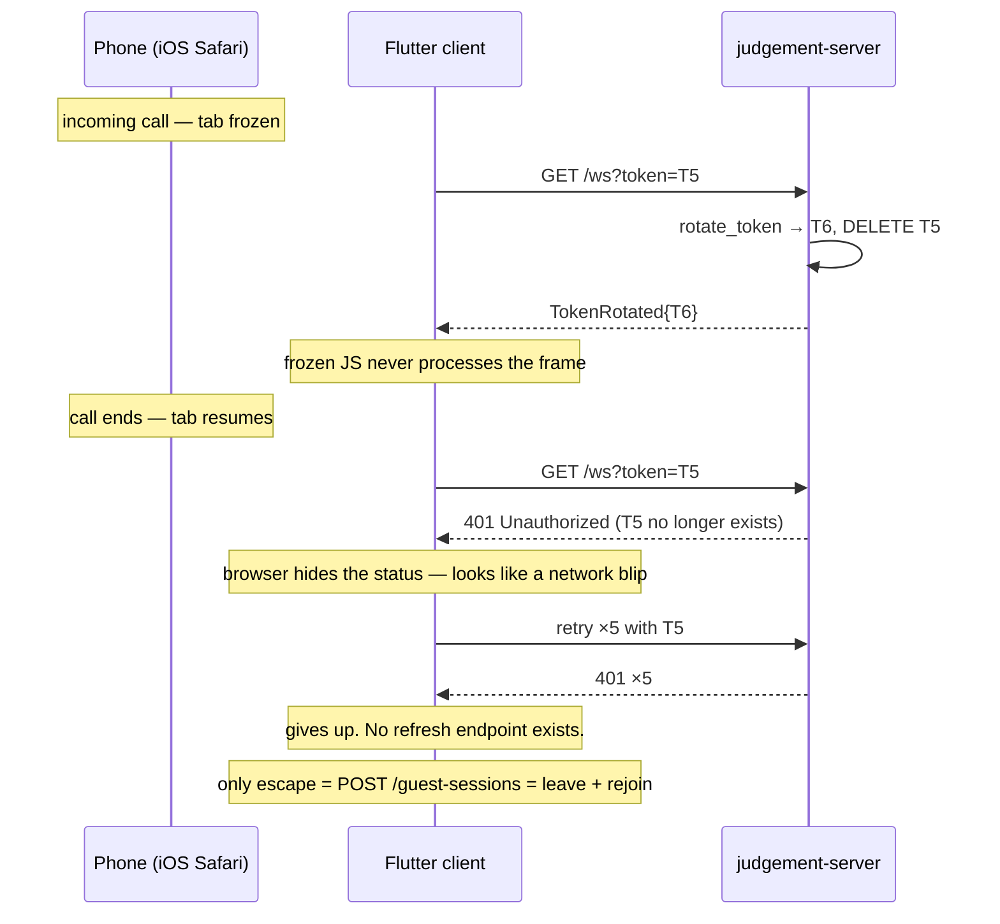

# Mobile Interruption Resilience — Root Cause Analysis & Fix Plan

**Symptom (production):** a player on mobile receives a phone call. When the call ends, the
player is disconnected and **cannot get back in** — the only recovery is to leave the table
and rejoin from the room code.

**Verdict:** this is not one bug. It is **one fatal bug (unrecoverable auth token) plus five
amplifiers**. The fatal bug alone fully explains the reported workaround, because minting a
new guest session is the *only* way the client can obtain a valid token once the old one is
burned. Everything else makes it more likely and uglier.

Status: analysis complete, no code changed. Fix phased P0–P3 below.

---

## 1. Executive summary

| # | Root cause | Severity | Evidence |
|---|---|---|---|
| **RC-1** | **WS token rotation is not atomic with delivery.** The old token is deleted server-side *before* the new one is delivered, and the new one is delivered only over the WebSocket — the very channel that just proved unreliable. A missed frame permanently locks the player out; there is no HTTP refresh path. | **Fatal** | `ws.rs:83`, `state.rs:269-278`, `actor.rs:348-350`, route table in `lib.rs:34-85` |
| **RC-2** | **12 s reconnect grace is shorter than any phone call.** Grace expiry vacates the seat, shows peers "left the table", pauses the whole game for 10 min, then aborts it. | High | `state.rs:30`, `actor.rs:31`, `actor.rs:446-506`, `fly.toml` (no override) |
| **RC-3** | **Client has no page-lifecycle awareness.** No reconnect trigger on resume; the retry ladder burns out while the tab is frozen. | High | `game_controller.dart` (no `WidgetsBindingObserver`); only `app_update.dart:161` observes lifecycle |
| **RC-4** | **Retry ladder is terminal.** 5 attempts / ≈31 s, no jitter, then it gives up forever. | High | `game_controller.dart:271`, `:313-324` |
| **RC-5** | **In-table reconnect never rehydrates the token from storage.** `connect()` reads in-memory `api.token`; a tab discarded under memory pressure reconnects with `token=null`. | Medium | `game_controller.dart:252-253`, `api_client.dart` `gameSocketUri` |
| **RC-6** | **Audio/mic session is not re-armed after an iOS interruption.** After the call, sounds and push-to-talk are silently dead — which is often what makes the player press *Leave*. | Medium | `table_media_session.dart` (unlock at join only) |
| **RC-7** | **The test suite structurally cannot reproduce this.** The harness auto-applies `TokenRotated`, so every reconnect test passes on a code path real mobile clients never take. | Process | `presence.rs:94` |

**The one-line fix that removes the reported workaround:** keep the previous token valid for a
short overlap window instead of deleting it on rotation (RC-1). Everything else is hardening.

---

## 2. Root cause 1 (fatal) — the burned token

### 2.1 The code

Rotation happens in the HTTP upgrade handler, **before** the socket exists:

```rust
// judgement-server/src/ws.rs:82-88
// Rotate the reconnect token on every successful WS upgrade (§15.1).
let rotated_token = state.rotate_token(session.id);
if let Some(ref token) = rotated_token {
    if let Some(updated) = state.session_for_token(token) {
        let _ = state.store.upsert_session(&stored_session(&updated)).await;
    }
}
```

Rotation is destructive and immediate:

```rust
// judgement-server/src/state.rs:269-278
pub fn rotate_token(&self, session_id: SessionId) -> Option<String> {
    let mut sessions = self.sessions.lock().unwrap();
    let mut tokens = self.tokens.lock().unwrap();
    let session = sessions.get_mut(&session_id)?;
    tokens.remove(&session.token);          // ← old token dies HERE
    let new_token = generate_token();
    session.token = new_token.clone();
    tokens.insert(new_token.clone(), session_id);
    Some(new_token)
}
```

The new token reaches the client **only over the WebSocket**:

```rust
// judgement-server/src/actor.rs:348-350
if let Some(token) = rotated_token {
    self.send_to(player_id, ServerMessage::TokenRotated { token });
}
```

### 2.2 The failure sequence



### 2.3 Why the mobile phone call makes this near-certain

Rotation is committed **before `on_upgrade`**, so the token is burned even by an upgrade that
never completes. During an incoming call, iOS does exactly the things that abort an in-flight
upgrade: it backgrounds Safari, freezes the page, cancels in-flight requests, and often
re-attaches the radio (Wi-Fi ⇄ LTE) on resume. Any one of those between the server's
`tokens.remove()` and the client's `case TokenRotated` handler burns the token.

### 2.4 Why the client cannot even detect it

Browsers deliberately hide the HTTP status of a failed WebSocket upgrade from JavaScript. The
client sees an opaque failure:

```dart
// game_controller.dart:251-268
try {
  final socket = await GameSocket.connect(api.gameSocketUri(gameId), ...);
  ...
} catch (_) {                 // ← 401 and "wifi dropped" are indistinguishable
  _handleDisconnect();
}
```

So it retries blindly with the dead token, and `manualReconnect()` (`:296-301`) reuses the same
dead token — it resets the counter, not the credential.

### 2.5 Why there is no escape

The full route table (`lib.rs:34-85`) has **no session refresh or resume endpoint**. The only
token-minting route is `POST /api/v1/guest-sessions`, which creates a brand-new `SessionId`
(`routes.rs` `create_guest_session`). A new session means a new identity, which means the seat
must be re-claimed — i.e. **leave the table and rejoin**. This is the user's exact report,
and it is the *only* path the current architecture offers.

> Note: the server-side reclaim logic is fine. `handle_connect` (`actor.rs:320-345`) explicitly
> handles `previous_status == Vacant` and restores the seat. The player is not blocked by
> presence logic — they are blocked at the door, by auth, before the actor is ever reached.

---

## 3. Root cause 2 — 12 s grace vs a phone call

```rust
// judgement-server/src/state.rs:30
pub const DEFAULT_RECONNECT_GRACE: Duration = Duration::from_secs(12);
// judgement-server/src/actor.rs:31
pub const VACANCY_TTL: Duration = Duration::from_secs(10 * 60);
```

`fly.toml` `[env]` sets `RUST_LOG`, `PORT`, `JUDGEMENT_MIGRATIONS_DIR`, `RAG_ENABLED` — **no
`RECONNECT_GRACE_SECONDS`**. Production runs the 12 s default.

Even when the token survives, a 40-second call produces:

1. `handle_disconnect` → silent grace, timers cancelled (`actor.rs:371-424`).
2. `PAUSE_BANNER_DELAY` 3 s → peers see *"Waiting for X to reconnect…"*.
3. Grace expires at 12 s → `mark_seat_vacant` (`actor.rs:467-506`) → peers see
   **"X left the table — share the room code so someone can take their seat"**. That message is
   factually wrong; the player is on a phone call.
4. `VACANCY_TTL` 10 min armed → `handle_vacancy_expired` → `handle_end_game(..., aborted)`
   (`actor.rs:458-465`). **A long call kills the entire table for everyone.**

There is also a **non-deterministic clock**. The server only learns of the disconnect when the
WS read loop breaks. If iOS sent a TCP FIN, that is immediate. If it merely froze the tab, the
browser stops answering pings and the server waits `LIVENESS_TIMEOUT = 45 s` (`ws.rs:24`) before
enqueuing `Disconnect`. So the observable vacancy time is either ~12 s or ~57 s depending on how
the OS tore down the socket. Two players on the same call length see different outcomes — that
unpredictability is itself a defect.

---

## 4. Root causes 3–5 — the client gives up

**RC-3, no lifecycle awareness.** `GameController` does not implement `WidgetsBindingObserver`.
The only lifecycle hook in the codebase is `app_update.dart:161`, for hosting-version re-checks.
Consequences: no reconnect trigger on resume; no way to stop burning attempts while hidden; no
`pagehide`/`freeze` signal telling the server "hold my seat, I'm backgrounding".

**RC-4, terminal ladder.**

```dart
// game_controller.dart:271, 313-324
static const _maxReconnectAttempts = 5;
...
final delay = Duration(milliseconds: 500 * pow(2, _reconnectAttempts).toInt());
```

1 s + 2 s + 4 s + 8 s + 16 s ≈ **31 s of total coverage** for an event that lasts minutes. No
jitter (so all four players at a table retry in lockstep, hammering the same instant). Worse,
while the tab is frozen these timers are throttled and then fire in a burst on resume, so all
five attempts can be spent in the first second after the call — before the radio is usable.
After that, `canManualReconnect` is the only affordance, and it reuses the dead token.

**RC-5, no token rehydration in-table.** `connect()` builds the URI from the in-memory
`api.token`. The reclaim blob in `localStorage` (`kReclaimTtl` 10 min, written by
`_persistReclaimStore()` on `TokenRotated`) *does* hold a usable token — but it is only read by
`room_rejoin.dart` in the lobby/claim flow, never by `GameController.connect()`. So a tab
discarded under memory pressure during a call reconnects with literally `?token=null`, while a
perfectly good token sits unread in storage.

---

## 5. Root cause 6 — audio dies silently

An incoming iOS call seizes the audio session: `AudioContext` moves to `suspended` and
`getUserMedia` tracks are muted or ended. `table_media_session.dart` performs its unlock at join
time only, and nothing re-arms on resume. The player returns to a table where card sounds and
push-to-talk are dead. This is frequently the trigger for pressing **Leave** even when the
socket did recover — so it belongs in the same fix, not a later one.

---

## 6. Root cause 7 — why CI was green

```rust
// judgement-server/tests/presence.rs:94
ServerMessage::TokenRotated { token } => self.token = token,
```

The test client always receives and applies the rotated token. Both
`silent_ws_blip_reconnects_without_vacant_or_host_change` (`presence.rs:722`) and
`same_session_reclaim_via_ws_after_vacant` (`presence.rs:375`) therefore exercise the *happy*
rotation path exclusively. **No test reconnects with a stale token**, which is the only case that
fails in production. There is also no `game_controller_test.dart` at all — the Flutter test
directory has no reconnect coverage, matching the open item in `CTO_PRODUCTION_REVIEW.md`.

---

## 7. Fix plan

Design constraint kept throughout: **the client requests, the server decides.** No fix below
moves legality, scoring, or seat ownership to the client.

### F1 — Token rotation grace window *(P0, fixes the reported bug)*

Make the previous token remain valid for a bounded overlap instead of dying instantly.

- `Session` gains `previous_token: Option<String>` and `previous_token_expires_at: Instant`.
- `rotate_token`: move the current token to `previous` with a `TOKEN_ROTATION_GRACE` (**120 s**)
  expiry, insert the new token. Do **not** remove the old one from the map yet.
- `session_for_token` accepts current **or** unexpired previous.
- Retire `previous` eagerly the moment the client proves it received the new token — on the first
  `ClientEnvelope` received over the socket opened with the new token.
- Reaper sweeps expired `previous` entries (`reaper.rs` already runs every 30 s).

Security posture is preserved: replay is still bounded (120 s instead of 0 s), single-use intent
is preserved for the common path, and the window closes early on proof of delivery. Trading a
0 s window for a 120 s one is the correct call, because today's 0 s window is bought with a
permanent lockout.

*Files:* `state.rs` (`Session`, `rotate_token`, `session_for_token`), `reaper.rs`.
*Estimate:* ~60 lines + tests.

### F2 — `POST /api/v1/sessions/refresh` *(P1, makes lockout impossible)*

An HTTP endpoint that exchanges a current-or-previous token for a fresh one, returning it **in
the HTTP response body** so delivery is confirmed by HTTP semantics rather than hoped for over a
WebSocket.

- Request: `Authorization: Bearer <token>`. Response: `{ token, session_id, nickname }`.
- 401 if the token is unknown or the previous-token grace has expired — an honest, decidable
  answer instead of an opaque WS failure.
- Behind the existing `rate_limit_middleware` (`lib.rs:78-81`).
- Persist via `store.upsert_session` exactly as `ws.rs:84-88` does.

*Long-term shape:* once F2 exists, rotate on **HTTP** (confirmed delivery) and stop rotating on
the WS upgrade entirely. F1 becomes belt-and-braces rather than the primary defence.

*Files:* `routes.rs`, `lib.rs`, `api_client.dart`.

### F3 — Client turns opaque failures into decidable ones *(P1)*

Since the browser hides the WS status, probe over HTTP:

1. WS connect fails → call `sessions/refresh`.
2. 200 → store the new token (durably, before retrying) → retry the WS immediately.
3. 401 → the session is genuinely gone → *now* show the rejoin affordance. This is the only case
   where "leave and rejoin" is the right answer, and it should be rare.

*Files:* `game_controller.dart`, `api_client.dart`.

### F4 — Presence model that survives a phone call *(P0 config, P2 model)*

**F4a (P0, config only):** set `RECONNECT_GRACE_SECONDS = '90'` in `fly.toml` `[env]`. Inside the
existing `0..=120` clamp (`state.rs:32-40`), so no code change. Covers short calls immediately.

**F4b (P2, the real fix):** 90 s still does not cover a 5-minute call, and pausing three other
players for one person's phone call is the wrong product behaviour anyway. Split the terminal
state in two, extending ADR 0004:

| State | Trigger | Table | Seat | Peers see |
|---|---|---|---|---|
| `Disconnected` | socket drop | frozen | reserved | nothing (silent) |
| `Disconnected` + banner | +3 s (`PAUSE_BANNER_DELAY`) | frozen | reserved | "Reconnecting…" |
| **`Away`** *(new)* | grace expiry (90 s) | **resumes — bot plays the seat** | **reserved for that session** | "X is away — bot is playing" |
| `Vacant` | `AWAY_TTL` (5 min) | paused, claimable | released | "X left — share the room code" |

`ConnectionStatus::BotControlled` already exists in ADR 0004; F4b wires it into the timeout path
instead of jumping straight to `Vacant`. Key win: **the other three players keep playing**, and
the returning player's seat is still theirs. `handle_connect` already restores from
`BotControlled` (`actor.rs:333-345`), so the reclaim path is largely in place.

Care required: `mark_seat_vacant` (`actor.rs:467-506`) currently conflates three concerns —
release the seat, pause the table, arm the 10-minute auto-end. F4b must move the pause and the
auto-end to the `Vacant` transition only, leaving `Away` non-pausing and non-terminal.

*Files:* `actor.rs`, `judgement-domain` (`ConnectionStatus`), `judgement-protocol`,
`docs/adr/0004-presence-grace-bot-takeover.md`, `docs/Architecture.md` §5.4.

### F5 — Lifecycle-aware, non-terminal reconnect ladder *(P0 minimal, P1 full)*

- `GameController implements WidgetsBindingObserver`.
- `paused` / `hidden` / `inactive` → set `_suspended = true`, cancel the pending retry timer, and
  **do not consume attempts**.
- `resumed` → `_reconnectAttempts = 0`, reconnect immediately (this is the natural, correct
  trigger and it is missing today).
- Backoff becomes `min(30 s, 500 ms · 2ⁿ)` with ±20 % jitter.
- **Remove the hard stop while the table is live** (`view != null && !isFinished && !gameAborted`):
  keep retrying at the 30 s ceiling forever. `canManualReconnect` stays as an *extra* affordance,
  not the only one.

*Files:* `game_controller.dart`.

### F6 — Durable token, written before the socket opens *(P0)*

- Persist the token **before** opening the socket, not only on `TokenRotated`, so an interrupted
  rotation always leaves a recoverable trail.
- Also call `_persistReclaimStore()` after a successful `connect()`.
- In `connect()`, if `api.token == null`, rehydrate from the reclaim blob before building the URI
  (fixes RC-5's literal `?token=null`).
- Closes the `CTO_PRODUCTION_REVIEW.md` open item *"session resume via short-TTL sessionStorage"*.

*Files:* `game_controller.dart`, `game_reclaim_store*.dart`.

### F7 — Re-arm media after interruption *(P3)*

- On `AppLifecycleState.resumed`, re-run the `table_media_session` unlock.
- Listen for `AudioContext` `statechange → suspended`; resume on the next user gesture.
- If push-to-talk was active, re-acquire the mic track rather than assuming the old one lives.

*Files:* `table_media_session.dart`, `voice_recorder*.dart`, `web_audio_playback*.dart`.

### F8 — Observability *(P0, one counter)*

`ApiError::Unauthorized` at `ws.rs:69` is **invisible in metrics** — this outage produced no
signal. Add:

- `ws_auth_rejected_total` (counter, incremented at `ws.rs:67-69`).
- `ws_upgrade_rejected_total{reason}` for the 404 / 403 branches (`ws.rs:74-78`).
- `session_refresh_total{outcome}` once F2 lands.
- `reconnect_recovered_total` — successful reconnects preceded by an auth failure.

With `ws_auth_rejected_total` alone, this bug would have been a five-minute diagnosis.

---

## 8. Test plan (closing RC-7)

**Rust — `tests/presence.rs`:**

- `stale_token_reconnect_succeeds_within_rotation_grace` — connect, capture `T5`, **deliberately
  discard the `TokenRotated` frame**, close, reconnect with `T5`, assert success. *This is the
  test that would have caught the production bug.*
- `rotation_grace_expiry_rejects_stale_token` — same, past `TOKEN_ROTATION_GRACE` → 401.
- `session_refresh_exchanges_stale_token_for_fresh` (F2).
- `session_refresh_rejects_unknown_token` (F2).
- `away_state_keeps_table_playing_and_reserves_seat` (F4b).
- `away_expiry_releases_seat_to_vacant` (F4b).
- `long_absence_does_not_abort_game` — regression guard on the `VACANCY_TTL` auto-end path.

**Flutter — new `test/game_controller_reconnect_test.dart`:**

- Lifecycle `resumed` triggers an immediate reconnect.
- Attempts are **not** consumed while `hidden`.
- Token rehydrates from the reclaim blob when `api.token == null`.
- The ladder does not terminate while the game is live.
- A refresh-then-retry succeeds after a simulated 401.

**Manual device matrix — the acceptance gate.** Real incoming call on iOS Safari and Android
Chrome, at 10 s / 60 s / 5 min durations, on Wi-Fi and on Wi-Fi→LTE handover. Pass criterion:
**the player returns to their own seat with no user action, and the other players' game is never
aborted.**

---

## 9. Phasing

| Phase | Contents | Outcome |
|---|---|---|
| **P0** — hotfix | F1, F4a (`fly.toml`), F5 minimal (lifecycle + resume trigger, no attempt burn while hidden), F6, F8 counter | **"Leave and rejoin" is no longer required.** Short calls recover invisibly. |
| **P1** | F2 refresh endpoint, F3 client use, F5 full ladder, Rust + Flutter tests | Lockout becomes structurally impossible; failures become decidable. |
| **P2** | F4b `Away` + bot plays, ADR 0004 amendment, Architecture.md §5.4 | Long calls stop pausing and stop killing tables. |
| **P3** | F7 media re-arm, remaining metrics, rotate-on-HTTP-only cleanup | Full-fidelity return: sound and voice work too. |

P0 is deliberately small — a token-map change, one `fly.toml` line, one lifecycle observer, one
storage write ordering fix, one counter. It carries no schema change, no protocol change, and no
UI change, so it is safe to ship ahead of the rest.

---

## 10. NFR impact

Neutral to positive against `docs/LOAD.md`.

- **No new DB work on the hot path.** F1 is in-memory map bookkeeping. F2 adds one
  `upsert_session` per refresh — rare, and it *replaces* today's failure mode of a full new-session
  create plus a seat claim, so expected DB load goes **down**.
- **Connection pool (10/process): unchanged.** No new query per command or per snapshot.
- **p95 command < 100 ms: unchanged.** `session_for_token` gains one extra map lookup and an
  `Instant` comparison on the miss path only.
- **200 concurrent WS: improved.** Jittered backoff removes the lockstep retry storm that four
  players at a table currently produce, and the retry ladder no longer thrashes an unusable radio.
- **F4b reduces load:** bot-plays-while-away lets tables finish instead of sitting paused for
  10 minutes holding an actor slot against the 100-actor soft cap.
- **Memory:** one `Option<String>` + one `Instant` per session, bounded by the reaper.

---

## 11. Docs to update

- `docs/adr/0004-presence-grace-bot-takeover.md` — amend for the `Away` state (F4b).
- New `docs/adr/0006-token-rotation-grace.md` — record F1/F2 and the security trade-off.
- `docs/Architecture.md` §4.3 (WS contract: refresh endpoint, rotation grace) and §5.4 (presence
  state diagram).
- `CTO_PRODUCTION_REVIEW.md` — close *"frontend session cliff"* and *"session resume via
  short-TTL sessionStorage"*; add the reconnect tests to the CI item.
- `deployment/fly.env.example` and `deployment/railway.env.example` — document
  `RECONNECT_GRACE_SECONDS` and the new `TOKEN_ROTATION_GRACE_SECONDS`.

---

## 12. Open decisions

1. **`TOKEN_ROTATION_GRACE` = 120 s?** Long enough to survive a radio handover, short enough to
   keep replay bounded. Recommend 120 s, env-overridable, clamped `0..=600`.
2. **Keep rotating on WS upgrade at all?** Recommend: after F2 ships, stop. Rotate only on HTTP
   where delivery is confirmed. F1 then becomes defence-in-depth.
3. **`AWAY_TTL` = 5 min?** Recommend 5 min, with the host able to release the seat sooner via the
   existing remove-player flow.
4. **Should `Away` be announced to peers?** Recommend yes — *"X is away, bot is playing"* is
   honest and far better than today's false *"X left the table"*.
